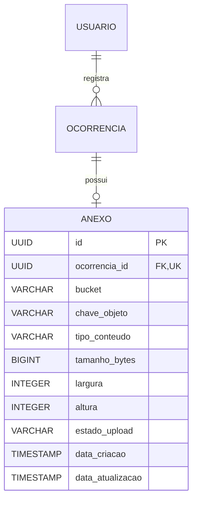

# Zelar.app Backend

API do Zelar.app com Java 21, Spring Boot, Maven e PostgreSQL.

## Pré-requisitos

- JDK 21 configurado no terminal ou no IntelliJ.
- PostgreSQL acessível com um banco vazio para a primeira execução.
- Maven Wrapper do projeto; não é necessário instalar Maven separadamente.

## Configuração

Configure as variáveis no ambiente do processo ou na configuração de execução do IntelliJ:

| Variável | Uso | Padrão |
| --- | --- | --- |
| `DB_URL` | URL JDBC, por exemplo `jdbc:postgresql://localhost:5432/zelar` | Obrigatória |
| `DB_USERNAME` | Usuário do banco | Obrigatória |
| `DB_PASSWORD` | Senha do banco | Obrigatória |
| `JWT_SECRET` | Chave aleatória de pelo menos 32 bytes codificada em Base64 | Obrigatória |
| `JWT_ISSUER` | Emissor aceito nos tokens | `zelar.app` |
| `JWT_TOKEN_DURATION` | Duração no formato ISO-8601 | `PT1H` |
| `SERVER_PORT` | Porta HTTP | `8080` |

Use `.env.example` como referência. Não versione credenciais reais e não reutilize a chave do perfil de testes. A aplicação iniciada pelo Maven ou IntelliJ não carrega um arquivo `.env` automaticamente.

As migrations Flyway versionadas em `src/main/resources/db/migration` criam o schema. O Hibernate usa `validate`: não substitua essa configuração por geração automática para contornar uma migration ausente.

## Execução e testes

No PowerShell, a partir da raiz do projeto:

```powershell
.\mvnw.cmd clean verify
.\mvnw.cmd spring-boot:run
```

Em Linux ou macOS, use `./mvnw`. A suíte padrão usa H2 em modo PostgreSQL; os testes de integração de autenticação validam o schema criado pelo Flyway. Isso não substitui a validação do ambiente com PostgreSQL real.

O Compose atual contém apenas o backend e espera um PostgreSQL acessível externamente. Para usá-lo, configure o `.env` e execute `docker compose up --build`. Dentro do container, `localhost` aponta para o próprio container; no Docker Desktop, `host.docker.internal` pode apontar para o banco no host. O mapeamento atual expõe `8080:8080`; alterar a porta exige alinhar configuração e mapeamento.

## Autenticação

| Método | Caminho | Comportamento |
| --- | --- | --- |
| POST | `/api/v1/usuarios` | Cadastro público de cidadão |
| POST | `/api/v1/auth/login` | Login público por email e senha |
| GET | `/api/v1/auth/me` | Consulta do próprio usuário autenticado |

Exemplo do corpo de login:

```json
{"email":"demo@example.com","senha":"SenhaDemo123"}
```

O login retorna `accessToken`, `tokenType` (`Bearer`), `expiresIn` em segundos e `usuario`, sem senha. Nas rotas protegidas, envie `Authorization: Bearer <accessToken>`.

O token usa HS256 e contém emissor, UUID do usuário, perfil, emissão e expiração. As claims não incluem nome, email, telefone ou senha. O conteúdo é assinado, não criptografado. A API é stateless; estes endpoints não implementam refresh token ou revogação de tokens.

## Conta administrativa

O cadastro público (`POST /api/v1/usuarios`) sempre cria `CIDADAO`; o corpo não aceita `perfil` e campos extras são ignorados. A conta `ADMINISTRADOR` só é criada pelo provisionamento no startup, quando as variáveis abaixo estão definidas:

| Variável | Uso | Padrão |
| --- | --- | --- |
| `ADMIN_EMAIL` | E-mail da conta administrativa | Obrigatória para provisionar |
| `ADMIN_PASSWORD` | Senha em texto, entre 8 e 72 caracteres; armazenada com BCrypt | Obrigatória para provisionar |
| `ADMIN_NOME` | Nome de exibição da conta | `Administrador` |

Comportamento do provisionamento:

- Sem `ADMIN_EMAIL` e `ADMIN_PASSWORD`, a aplicação inicia normalmente e nenhuma conta é criada — não há credenciais padrão em nenhum ambiente.
- Com ambas definidas, a conta é criada como `ADMINISTRADOR` na inicialização e o procedimento é registrado em log apenas com o e-mail — a senha nunca aparece.
- Execução repetida é segura: se o e-mail já existir, nada é criado nem alterado. Um e-mail já cadastrado como `CIDADAO` não é promovido — nesse caso o log avisa e é preciso escolher outro e-mail ou ajustar o banco manualmente.
- Definir apenas uma das duas variáveis interrompe a inicialização com erro explícito, evitando configuração parcial silenciosa.
- O e-mail é validado com as mesmas regras do login (formato válido, até 150 caracteres) antes de qualquer gravação. Configuração inválida interrompe a inicialização sem persistir usuário e sem expor a senha.
- Após a conta ser provisionada, remova `ADMIN_EMAIL`, `ADMIN_PASSWORD` e `ADMIN_NOME` do ambiente: a conta já existe e manter a senha exportada só aumenta a superfície de vazamento.

Para validar o fluxo administrativo: configure as três variáveis no ambiente, suba a aplicação, autentique em `POST /api/v1/auth/login` com as credenciais provisionadas e use o `accessToken` retornado nas rotas protegidas.

As respostas de erro seguem `ApiError`: 400 para entrada inválida, 401 para autenticação inválida, 403 para falta de permissão, 404 para recurso inexistente e 409 para conflito como email duplicado. Somente os dois POSTs públicos acima dispensam autenticação; os demais métodos e caminhos são protegidos.

## Integração contínua

O GitHub Actions executa `clean verify` com Java 21 e o build da imagem Docker em PRs e pushes para `develop`, `stage` e `main`.

## Criação de ocorrências

`POST /api/v1/ocorrencias` exige `Authorization: Bearer <accessToken>` e um corpo JSON:

```json
{
  "categoria": "BURACO",
  "descricao": "Buraco na via próximo à praça",
  "latitude": -12.97,
  "longitude": -38.50,
  "enderecoAproximado": "Praça central"
}
```

Categorias aceitas: `BURACO`, `ILUMINACAO`, `LIXO`, `ALAGAMENTO`, `CALCADA`, `SINALIZACAO` e `AMBIENTAL`. Categoria e descrição são obrigatórias; latitude deve estar entre -90 e 90 e longitude entre -180 e 180. Endereço é opcional, com até 255 caracteres.

A resposta é `201 Created`, com UUID, `usuarioId`, os dados da ocorrência, status `ENVIADA`, prioridade nula e data de criação. O autor é obtido do token; enviar `usuarioId`, `status` ou `prioridade` no corpo não altera esses valores controlados pelo servidor. A resposta não inclui nome, email, telefone ou senha do autor. Se o usuário do token não existir mais, a API retorna 401 sem persistir a ocorrência.

Para conferir o fluxo com PostgreSQL, use um banco de validação separado, configure as variáveis acima e inicie a aplicação. Confirme a aplicação das migrations e a inicialização com `ddl-auto=validate`; cadastre um cidadão, faça login e crie ocorrências das sete categorias. Verifique 400 para coordenadas inválidas e 401 sem token, além da persistência após reiniciar a aplicação. Não execute limpeza ou geração automática de tabelas em um banco compartilhado.

## Listagem de ocorrências

`GET /api/v1/ocorrencias` exige autenticação. Cidadãos consultam somente suas próprias ocorrências; administradores consultam todas. O serviço confirma a existência da conta e usa seu perfil atual no banco para aplicar a regra. O autor da consulta vem do token, não de um parâmetro `usuarioId`.

| Parâmetro | Uso | Padrão e limites |
| --- | --- | --- |
| `pagina` | Índice da página, começando em zero | 0; inteiro não negativo |
| `tamanho` | Quantidade máxima por página | 20; de 1 a 100 |
| `status` | Filtro opcional | `ENVIADA`, `EM_ANALISE` ou `RESOLVIDA` |
| `prioridade` | Filtro opcional | `BAIXA`, `MEDIA` ou `ALTA` |

Os filtros são combinados por igualdade e respeitam a visibilidade do usuário. A ordenação é fixa: `dataCriacao` decrescente, com desempate por `id` decrescente. Não há parâmetro de ordenação arbitrária nesta versão.

Exemplo: `GET /api/v1/ocorrencias?pagina=0&tamanho=10&status=ENVIADA`.

Resposta `200 OK`:

```json
{
  "conteudo": [],
  "pagina": 0,
  "tamanho": 10,
  "totalElementos": 0,
  "totalPaginas": 0
}
```

Cada item de `conteudo` usa `OcorrenciaResponse`, com os mesmos campos da resposta de criação. Não há entidade `Usuario` nem seus dados pessoais na listagem. A ausência de resultados retorna uma lista vazia; uma página fora do conjunto mantém os totais e devolve conteúdo vazio.

Parâmetros inválidos retornam 400 no formato `ApiError`. Ausência de autenticação, token inválido ou usuário removido retornam 401. A listagem não implementa indicadores agregados ou alteração de status/prioridade.

Os testes `OcorrenciaListagemIntegrationTest` exercitam tokens reais, visibilidade, filtros, limites, paginação e desempate de ordenação com Flyway e Hibernate validate. A suíte padrão continua usando H2; para PostgreSQL real, repetir o fluxo em banco separado com dois cidadãos e um administrador provisionado de forma controlada, conferindo a visibilidade e os totais de cada perfil.

## Consulta de ocorrência por ID

`GET /api/v1/ocorrencias/{id}` exige `Authorization: Bearer <accessToken>` e um identificador UUID. Retorna `200 OK` com `OcorrenciaResponse`, incluindo identificadores, categoria, descrição, localização, status, prioridade e datas. Não retorna a entidade `Usuario` nem nome, email, telefone ou senha do autor.

Cidadãos consultam somente as próprias ocorrências; administradores consultam todas. O serviço usa o perfil atual da conta no banco e aplica a mesma regra de visibilidade da listagem na consulta SQL. Um parâmetro `usuarioId` enviado pelo cliente não troca a identidade da consulta.

Ocorrência inexistente ou fora do acesso do usuário retorna `404 Not Found` com a mesma mensagem `Ocorrência não encontrada.`, sem revelar se existe um registro de outra conta. Identificador inválido retorna 400 no formato `ApiError`. Ausência de autenticação, token inválido ou usuário removido retorna 401.

O endpoint é somente de leitura. Fotografias permanecem em sua tarefa; as atualizações de prioridade e status possuem endpoints próprios, descritos abaixo. Os testes `OcorrenciaConsultaIntegrationTest` cobrem consulta pelo autor e por administrador, tentativa de acesso de outro cidadão, UUID inválido, recurso ausente, conta removida e uso do perfil atual mesmo com token administrativo ainda válido.

## Atualização de prioridade

`PATCH /api/v1/ocorrencias/{id}/prioridade` exige `Authorization: Bearer <accessToken>` e um corpo JSON como `{"prioridade":"ALTA"}`. A operação é restrita ao perfil `ADMINISTRADOR` atual da conta no banco; um cidadão não pode alterar prioridade, mesmo sendo o autor da ocorrência. O UUID do usuário é obtido do token.

Prioridades aceitas: `BAIXA`, `MEDIA` e `ALTA`. Uma ocorrência continua sendo criada sem prioridade. O administrador pode atribuir ou trocar a prioridade em qualquer status, inclusive em uma ocorrência resolvida; essa operação não altera seu andamento. Enviar `null` ou omitir a prioridade retorna 400, sem remover o valor existente. Repetir a mesma prioridade retorna sucesso sem modificar `dataAtualizacao`.

Uma mudança retorna `200 OK` com `OcorrenciaResponse` e atualiza `dataAtualizacao`. Autor, categoria, descrição, localização, status e data de criação são preservados; campos extras enviados no JSON não alteram esses atributos. A prioridade pode ser consultada na listagem e na consulta por ID, respeitando suas regras de visibilidade, e nos filtros de listagem já existentes. Não há dados pessoais do autor na resposta.

A operação é transacional e bloqueia o registro durante a leitura. O método de leitura com bloqueio é compartilhado com a atualização de status, evitando que as duas operações sobrescrevam outros campos em requisições concorrentes. Atualizações concorrentes de prioridade são serializadas; entre duas prioridades diferentes, prevalece a última alteração efetivamente aplicada.

Respostas de erro no formato `ApiError`: 400 para UUID ou corpo inválido; 401 para autenticação inválida ou conta removida; 403 para cidadão, antes de buscar a ocorrência; 404 para ocorrência inexistente quando consultada por administrador. Valores fora do domínio são recusados. A operação não exige migration, pois a coluna e as constraints de prioridade já fazem parte do schema.

Os testes de domínio cobrem atribuição, todas as combinações de troca e repetição e recusa de prioridade nula. Os testes do serviço conferem autorização antes da busca, leitura bloqueada e recurso ausente. `OcorrenciaPrioridadeIntegrationTest` cobre persistência com Flyway e Hibernate validate, reflexo na consulta/listagem, todos os status, entrada inválida, conta removida, perfil atualizado no banco e preservação dos demais atributos. A suíte padrão usa H2; a validação de PostgreSQL deve ocorrer em banco separado, conferindo também concorrência e persistência após reinício.

Validação da BE-14: 42 casos novos (23 de integração, 13 de domínio e 6 de serviço), com 201 testes aprovados na suíte completa. O fluxo também foi conferido em PostgreSQL 17 isolado, incluindo duas requisições concorrentes, preservação dos campos e reinício da aplicação. Execução local em Java 24, compilando para Java 21; Java 21 e imagem Docker permanecem para validação no CI.

## Atualização de status

O fluxo do MVP é `ENVIADA → EM_ANALISE → RESOLVIDA`, sem salto de etapas, retorno, reabertura ou repetição do mesmo estado. A regra está registrada na DOC-01 do repositório de documentação. Somente administrador pode executar a mudança; o serviço confirma o perfil atual no banco.

`PATCH /api/v1/ocorrencias/{id}/status` exige Bearer e um corpo JSON como `{"status":"EM_ANALISE"}`. Retorna `200 OK` com `OcorrenciaResponse`, atualizando `dataAtualizacao` e preservando os demais dados. Autor, prioridade, descrição e demais campos extras no JSON não alteram os atributos da ocorrência.

Transição fora do fluxo retorna 409. Recurso ausente retorna 404. Cidadão recebe 403 antes da busca da ocorrência. Autenticação inválida ou conta removida retorna 401. Status ausente, desconhecido, JSON malformado ou identificador inválido retorna 400. Os erros seguem `ApiError`.

A atualização é transacional e utiliza bloqueio da ocorrência durante a leitura para impedir que alterações concorrentes validem o mesmo estado antigo. O novo status é refletido nas consultas autorizadas, inclusive na listagem filtrada. A criação de uma conta administrativa segue o procedimento de provisionamento descrito acima; o cadastro público continua criando apenas cidadãos.

Os testes de domínio verificam todas as transições entre os três estados. OcorrenciaStatusIntegrationTest cobre autorização, entrada inválida, persistência e reflexo na listagem. Para validação adicional em PostgreSQL separado, conferir também duas requisições simultâneas com o mesmo destino: apenas uma deve aplicar a transição, e a outra deve receber 409. As credenciais e a conta administrativa usadas como fixtures de validação não devem ser publicadas.

## Indicadores administrativos

`GET /api/v1/ocorrencias/indicadores` exige `Authorization: Bearer <accessToken>` e o perfil `ADMINISTRADOR` atual da conta no banco. Retorna `200 OK` com as contagens globais de ocorrências por status:

```json
{"enviadas":0,"emAnalise":0,"resolvidas":0}
```

Cada campo é um contador inteiro de 64 bits, inclusive quando o valor é zero. `enviadas` corresponde a `ENVIADA`, `emAnalise` a `EM_ANALISE` e `resolvidas` a `RESOLVIDA`. A consulta inclui todos os autores, conforme a visibilidade administrativa, e não retorna ocorrências nem dados pessoais.

Este endpoint não recebe filtros ou paginação. Parâmetros da listagem, como `status`, `prioridade`, `usuarioId`, `pagina` ou `tamanho`, não alteram as contagens globais. Os filtros existentes continuam disponíveis em `GET /api/v1/ocorrencias`. O caminho literal `/indicadores` não é interpretado como UUID pela consulta individual.

O serviço verifica a conta e sua autorização antes de executar uma única consulta agregada no banco, em transação somente de leitura. Não carrega as ocorrências em memória nem faz três consultas separadas. Novas consultas refletem criações e alterações de status já persistidas; não há cache de contagens nem necessidade de migration.

Erros no formato `ApiError`: 401 para autenticação inválida ou conta removida; 403 para cidadão, inclusive se o banco estiver vazio. O perfil atual no banco prevalece sobre o perfil antigo de um JWT ainda válido. O endpoint não altera registros.

`OcorrenciaIndicadoresIntegrationTest` cobre banco vazio, cada status isolado, múltiplos autores e status, criação via API e alterações de status persistidas como fixtures de teste, resposta sem dados pessoais e autorização. O teste de alterações persistidas complementa os testes próprios do fluxo HTTP de status da BE-10. Os testes do serviço verificam autorização antes da consulta e preservação de contadores de 64 bits. A suíte padrão usa H2 com Flyway e Hibernate validate nos testes de integração; a consulta agregada também deve ser conferida em PostgreSQL separado e após reinício.

Validação da BE-15: 15 testes novos (12 de integração e 3 de serviço), com 174 testes aprovados na suíte completa desta branch. PostgreSQL 17 isolado validou banco vazio, criação via API, mudanças de status persistidas como fixtures, múltiplos autores, escopo global, autorização e reinício. Execução local em Java 24, compilando para Java 21; Java 21 e imagem Docker permanecem para validação no CI.

## Fotografias de ocorrências (BE-13)

O backend implementa envio e consulta de uma fotografia opcional por ocorrência, com metadados da DB-09 e arquivo em bucket privado do Supabase Storage. A criação de ocorrência continua aceitando JSON e não exige foto.

### Endpoints

| Operação | Contrato |
| --- | --- |
| `POST /api/v1/ocorrencias/{id}/fotografia` | Bearer do Zelar, somente autor, multipart com campo `foto`. Retorna 201 e `Location` do recurso, com JSON contendo `id`, `tipoConteudo`, `tamanhoBytes`, `largura` e `altura`. Sem substituição no MVP. |
| `GET /api/v1/ocorrencias/{id}/fotografia` | Bearer do Zelar, autor ou administrador autorizado pelo perfil atual no banco. Retorna bytes JPEG/PNG, `Cache-Control: no-store, private` e `X-Content-Type-Options: nosniff`. |

As respostas de ocorrência incluem `possuiFotografia`, verdadeiro somente quando o vínculo está `DISPONIVEL`. Detalhe, listagem e atualizações administrativas preservam esse indicador. A listagem verifica os anexos dos registros da página em lote, sem uma consulta adicional por ocorrência. Bucket, chave do objeto e credenciais não aparecem nas respostas.

Os erros seguem `ApiError`: 400 para arquivo ausente/inválido, UUID inválido ou tipo incompatível; 401 para autenticação inválida/conta removida; 403 para administrador tentando enviar em nome de outro autor; 404 para ocorrência fora do escopo, inexistente ou fotografia ausente/não disponível; 409 para fotografia existente ou envio pendente; 413 quando o parser multipart recusa o tamanho; 503 para armazenamento indisponível ou falha na conclusão do envio. O excesso detectado pelo validador de conteúdo retorna 400; o limite de transporte retorna 413.

### Conteúdo e autorização

`ValidadorFotografia` aceita somente JPEG/PNG, compara MIME declarado com conteúdo real, limita o arquivo recebido e o resultado regravado a 5 MiB, cada lado a 8192 pixels e a área a 16 milhões de pixels. Regrava a imagem sem metadados e conteúdo adicional. O caminho usa UUID e extensão derivados pelo backend, sem aproveitar o nome original. O limite multipart é 5 MiB por arquivo e 6 MiB por requisição para acomodar os cabeçalhos.

`FotografiaAcessoService` reutiliza a consulta de ocorrência e seu escopo. A autorização antecede qualquer chamada ao Storage. Cidadãos não conseguem distinguir ocorrência inexistente de uma ocorrência de outro autor. O perfil atual no banco prevalece sobre o perfil antigo do JWT.

### Reserva, falhas e recuperação

1. Validar acesso e arquivo. Sem armazenamento habilitado/configurado, responder 503, sem reservar anexo.
2. Reservar o vínculo `PENDENTE` em transação independente e confirmada, com bloqueio da ocorrência e unicidade do vínculo.
3. Enviar o arquivo à chave reservada, sem sobrescrita. A chamada externa ocorre fora da transação de banco.
4. Confirmar `DISPONIVEL` em outra transação. Somente então retornar 201 e permitir a consulta.

Se o upload ou a confirmação falhar, preservar o vínculo/chave e tentar marcar `LIMPEZA_PENDENTE`. Se essa sinalização falhar, a reserva `PENDENTE` já confirmada continua recuperável. Uma possível confirmação já persistida como `DISPONIVEL` não é convertida em falha por compensação.

Com fotografias habilitadas, `FotografiaRecuperacaoJob` executa a cada minuto. Processa até 20 registros pendentes com última atualização há pelo menos 10 minutos. Reivindica o registro com bloqueio, confirma o estado de limpeza, solicita exclusão idempotente no bucket e só então remove o metadado. Se a exclusão ou a remoção do metadado falhar, mantém o vínculo para outra tentativa. Fotografias disponíveis e reservas recentes ficam fora da limpeza. Registros de outro bucket permanecem pendentes em vez de excluir um objeto no bucket errado.

Durante a recuperação, uma nova tentativa de envio recebe 409 e deve aguardar a liberação do vínculo. Depois da limpeza, repetir somente o envio da foto à mesma ocorrência. As transações do PostgreSQL não abrangem o Supabase. A recuperação é eventual, depende da disponibilidade do provedor e usa uma carência superior aos timeouts do cliente; não constitui garantia de atomicidade distribuída ou proteção contra alterações manuais no bucket/banco. Não há endpoint de exclusão/substituição de fotos no MVP.

### Configuração local e Docker

Criar o bucket privado `ocorrencias-fotografias` no Supabase, com restrição a JPEG/PNG e 5 MiB. Configurar no ambiente do processo, no IntelliJ ou no `.env` consumido pelo Compose/launcher:

```dotenv
FOTOGRAFIAS_HABILITADAS=true
SUPABASE_STORAGE_URL=https://seu-projeto.supabase.co
SUPABASE_STORAGE_BUCKET=ocorrencias-fotografias
SUPABASE_STORAGE_SECRET_KEY=
```

`SUPABASE_STORAGE_URL` é somente a origem HTTPS do projeto. Preencher `SUPABASE_STORAGE_SECRET_KEY` com uma secret key do servidor (`sb_secret_...`). A chave pública e o JWT do Zelar não substituem essa chave. Ela nunca deve ir para o frontend, variável `VITE_*`, repositório ou logs. O adaptador REST utiliza o cabeçalho `apikey`, conexão de até 5 segundos, leitura de até 20 segundos e não segue redirecionamentos. Não realiza repetição automática de upload.

O padrão é `FOTOGRAFIAS_HABILITADAS=false`: o restante da aplicação inicia sem credenciais de Storage. O `.env` não é carregado automaticamente pelo Spring Boot executado sozinho; configurar as variáveis no IntelliJ/terminal ou usar o Compose/launcher que lê esse arquivo. Reiniciar o backend para aplicar mudanças de configuração, após integrar e validar as migrations necessárias.

Referências do fornecedor: [chaves de API](https://supabase.com/docs/guides/getting-started/api-keys), [bucket privado e restrições](https://supabase.com/docs/guides/storage/buckets/fundamentals) e [download autenticado](https://supabase.com/docs/guides/storage/serving/downloads).

### Integração do frontend

O cliente deve criar a ocorrência em JSON e enviar a foto ao endpoint próprio usando o ID retornado. Se a segunda etapa falhar, guardar esse ID e repetir somente o envio, sem criar outra ocorrência. Um 409 após uma tentativa com resultado incerto exige consultar `possuiFotografia`: se verdadeiro, o envio já concluiu; se falso, há recuperação pendente.

Para exibir a imagem, buscar os bytes com Bearer e criar uma URL temporária do navegador. Revogar essa URL quando o componente deixar de usá-la ou a sessão mudar. Uma tag de imagem com URL direta não envia o token do Zelar. A adaptação do cliente HTTP e das telas do frontend é uma entrega separada; esta branch altera somente o backend e não retira o bloqueio antigo do frontend.

### Validação

Em 26/10/2026: 398 testes aprovados na suíte completa, sem falhas/erros/ignorados. Em PostgreSQL 17.11 vazio, 72 casos aprovados: 54 da migration e 18 do ciclo HTTP, com Flyway V1–V5 e Hibernate validate incluindo a entidade `Anexo`. Os cenários incluem envio/consulta, perfis, conta removida, foto inválida, duplicidade, dois envios simultâneos, indicador nas consultas/atualizações, reservas confirmadas antes da chamada externa, falha do Storage, falha de confirmação/sinalização, recuperação e preservação de fotos disponíveis. O limite multipart também foi exercitado por HTTP real em porta aleatória.

Os testes usam HTTP simulado para o Supabase, sem comprovar credenciais, permissões ou conectividade de um bucket real. Essa verificação continua pendente da configuração local. Execução local em Java 24 com compilação para Java 21. A CI configura Java 21 e passa a executar os testes da migration e das fotografias em PostgreSQL temporário. O push permanece manual; a CI executa automaticamente após o envio e a abertura do PR.


## Metadados de fotografias (DB-09)

A migration `V5__criar_tabela_anexo.sql` cria o schema necessário para a BE-13. Ela sucede a V4 da DB-06 e preserva V1 a V4. Uma ocorrência continua válida sem fotografia: o vínculo parte de `anexo`, sem nova coluna obrigatória em `ocorrencia`.

O contrato segue a preparação da branch `feature/ocorrencia-photos`: uma fotografia JPEG/PNG por ocorrência, conteúdo de até 5 MiB, bucket privado e acesso mediado pelo backend. A entrega independente da DB-09 trata do schema, testes e documentação. Nesta branch, a BE-13 já integra entidade/repositório, upload, consulta, configuração do Supabase e recuperação, conforme descrito acima.

### Modelo relacional



| Campo | Tipo e regra |
| --- | --- |
| `id` | UUID obrigatório, PK, gerado pelo backend |
| `ocorrencia_id` | UUID obrigatório, FK para `ocorrencia.id`, UNIQUE |
| `bucket` | VARCHAR(100), obrigatório, nome com letras minúsculas, números e hífen |
| `chave_objeto` | VARCHAR(255), obrigatório, UUID em minúsculas seguido de `.jpg` ou `.png` |
| `tipo_conteudo` | VARCHAR(50), obrigatório, `image/jpeg` ou `image/png`, correspondente à extensão |
| `tamanho_bytes` | BIGINT obrigatório, de 1 a 5.242.880, referente ao conteúdo validado e regravado |
| `largura`, `altura` | INTEGER obrigatório, de 1 a 8192 por lado, até 16.000.000 de pixels no total |
| `estado_upload` | VARCHAR(20) obrigatório, padrão `PENDENTE`, valores descritos abaixo |
| `data_criacao` | TIMESTAMP obrigatório, padrão `CURRENT_TIMESTAMP` |
| `data_atualizacao` | TIMESTAMP obrigatório, padrão inicial `CURRENT_TIMESTAMP`; o backend deve atualizar nas mudanças |

`UNIQUE (bucket, chave_objeto)` impede que o mesmo objeto represente dois anexos. A FK usa `ON DELETE RESTRICT` e a unicidade por ocorrência evita dois vínculos concorrentes, inclusive enquanto o envio está pendente. Os índices das constraints UNIQUE atendem à busca por ocorrência/objeto; `idx_anexo_estado_atualizacao` apoia a futura recuperação de operações interrompidas.

O banco armazena metadados, sem binário, nome original do arquivo, chave secreta ou URL assinada/pública. As constraints não verificam o conteúdo do arquivo: essa validação permanece no backend.

### Estados de envio e exclusão

| Estado | Significado para a futura BE-13 |
| --- | --- |
| `PENDENTE` | Vínculo e chave reservados e confirmados no banco antes da chamada ao Storage |
| `DISPONIVEL` | Backend confirmou o envio e publicou o vínculo para consulta |
| `LIMPEZA_PENDENTE` | Operação precisa de compensação ou verificação do resultado no Storage |

Fluxo previsto: validar/autorização, reservar o vínculo em transação confirmada, enviar o arquivo com a chave conhecida e marcar `DISPONIVEL` em outra transação. Exibir apenas anexos disponíveis. Em resultado incerto ou falha, preservar a chave e registrar necessidade de recuperação. Uma nova tentativa não deve substituir arquivo ou apagar vínculo enquanto a situação anterior não estiver resolvida. A futura reconciliação precisa distinguir uma operação interrompida de uma ainda em execução.

A DB-09 fornece os estados duráveis e as constraints, sem implementar a máquina de estados, o processo de recuperação ou uma transação distribuída. A FK impede apagar a ocorrência deixando de controlar o objeto no Storage. Uma exclusão futura deve remover/confirmar a ausência do objeto antes de apagar seu metadado e, só então, permitir remover a ocorrência. Se o Storage falhar, manter o registro para recuperação. SQL direto que apague `anexo` ou exclusão manual no bucket não recebem essa garantia automaticamente. O MVP não disponibiliza endpoint de exclusão/substituição de fotografia.

### Validação reproduzível

`AnexoMigrationIntegrationTest` roda por padrão em H2 no modo PostgreSQL, com Flyway e `spring.jpa.hibernate.ddl-auto=validate`. Verifica metadados obrigatórios, formatos, limites, FK, unicidades, restrição de exclusão, estados e compatibilidade com ocorrência sem foto. Um cenário separado cria schema exclusivo na V4, insere uma ocorrência, aplica a V5 e verifica preservação e repetição sem reaplicar migrations. O cenário remove somente o schema que ele próprio criou.

Para executar os mesmos testes em **PostgreSQL vazio e exclusivo de testes**, configure no ambiente do processo:

```dotenv
DB09_TEST_URL=jdbc:postgresql://localhost:55439/zelar_migrations_test
DB09_TEST_USERNAME=usuario_de_teste
DB09_TEST_PASSWORD=
```

O usuário de testes precisa criar/remover schemas no banco exclusivo para o cenário de upgrade. Não apontar essas variáveis para o banco da aplicação. Execute `./mvnw -Dtest=AnexoMigrationIntegrationTest test` (Windows: `./mvnw.cmd -Dtest=AnexoMigrationIntegrationTest test`). As fixtures normais usam rollback e os cenários inválidos usam savepoints para recuperar a transação após a rejeição de uma constraint no PostgreSQL.

O workflow `maven.yml` mantém a compilação/testes/build Docker e acrescenta um job com PostgreSQL 17 temporário para essa suíte. A credencial do container é exclusiva de CI, sem vínculo com o Supabase ou ambientes reais. Na entrega independente da DB-09, o Hibernate validou as entidades existentes e a tabela de anexo foi verificada por JDBC/constraints. Nesta BE-13, a entidade `Anexo` também integra o Hibernate validate, com teste em PostgreSQL real.

### Ordem de integração

Integrar esta DB-09 sobre a `develop` com a V4 da DB-06. A DB-07 foi integrada pelo PR #84 e esta branch já incorpora essa base. A branch `feature/ocorrencia-photos` incorporou localmente a DB-09 para implementar os endpoints. O PR #85 continua sendo a entrega independente da migration. A branch alternativa `feat/foto-resolver`, baseada em S3 e outra V4 de fotografias, ficou fora deste contrato por decisão do responsável; não integrar sua migration como se fosse parte desta entrega.

Referência sobre constraints e índices de unicidade: [documentação do PostgreSQL 17](https://www.postgresql.org/docs/17/ddl-constraints.html).

Validação local da DB-09 em 26/10/2026: 308 testes aprovados na suíte completa desta branch (254 da base e 54 novos), sem falhas, erros ou casos ignorados. Os mesmos 54 casos passaram em PostgreSQL 17.11 vazio, com Flyway V1–V5, Hibernate validate das entidades existentes e cenário de upgrade V4–V5. O PostgreSQL temporário foi encerrado ao final. Execução local em Java 24 com compilação para Java 21; a execução do novo job de CI em Java 21 depende do push manual e da abertura do PR. Os 64 testes da preparação da BE-13 permanecem na branch independente de fotografias.
